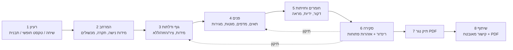

<!-- Exported from Obsidian: BanAI/11 - bobHabanai Characterization.md. The vault copy is the source of truth. -->
---
project: BanAI
type: characterization
branch: bobHabanai
status: approved
tags: [banai, bobhabanai, phase-1, characterization]
---

# bobHabanai: אפיון (שלב 1)

**סטטוס:** ✅ אושר (16.10.2026), ההחלטות בסעיף 10. **ענף:** `bobHabanai` (fork `ariel-korenn/banai`).

**מקורות:** `docs/research/carpentry-wardrobes-research.md` (מספרי המקור בסוגריים מרובעים, כמו [97], מפנים לטבלת המקורות שם), [[06 - Product Specification]], `docs/schema.md`, והקוד בענפים `bobHabanai` ו-`uxui`. החלטות: [[04 - Decisions & Assumptions]] (ADR-007 עד ADR-014).

> **הקשר (ADR-014):** תרגיל לימודי, דמה לחלוטין, ברמה גבוהה. האיסורים, החוק והממשל הצוותי משניים. הדגש הוא איכות ויכולת.

## 1. תקציר: מה נשאר ומה משתנה

**היקף:** ארונות בגדים בלבד: ארון ישר ונישה מקיר לקיר (ADR-012, Q4).

**נשאר**, כי זה בסיס טוב:
- פרוטוקול ops אחיד ומנוע כפול (Python מוסמך, JS מיידי) עם fixtures לבדיקת זהות (ADR-001)
- הצעות AI חתומות שדורשות אישור (ADR-002)
- persistence מאובטח: RLS שחוסם הכול, טוקן ב-fragment (ADR-003, ADR-004)
- קשיחות קלט מול LLM (ADR-006)

**משתנה:**

| נושא | היום | מוצע |
|---|---|---|
| תוצר סופי | עיצוב שמור + תמונה המחשתית | **תיק נגר PDF** (Python) שנגזר מהמודל הקנוני, כולל רשימת חיתוך |
| ידע מקצועי | "אין כללי היתכנות" | **שכבת ייעוץ**: אזהרות שלא חוסמות, עם מקור ודרגת ראיה (סעיף 4) |
| נתוני אתר | אין | מידות נישה, תקרה ומכשולים, **לא** תכנון חדר (סעיף 5) |
| חומרים | חומר × צבע × גימור, כצירים בלתי תלויים | **דקור**: ספק, קוד, עובי וטקסטורת PBR (סעיף 5.3) |
| עובי ברירת מחדל | 18 מ"מ | **17 מ"מ** (המלמין הסטנדרטי בישראל [59–62]) |
| שפה וכיוון | אנגלית, LTR | **עברית, RTL** (Q8) |
| שפת עיצוב | Material Design 3 (PR #3) | אפלי. **לא נשענים על PR #3** (ADR-013) |
| ויזואליזציה | Three.js + עריכת תמונה ב-AI | שני מצבים: חי, ורינדור path tracing (ADR-008, סעיף 7) |

## 2. משתמשים

| משתמש | מה הוא צריך | הערה |
|---|---|---|
| **בעל בית** (המשתמש הראשי, Q1) | לדמיין את הארון, להבין פשרות, להגיע לנגר עם בקשה ברורה | הדרכה והגנה מטעויות, בלי ז'רגון |
| **נגר** (קורא התיק) | כוונה ברורה, מידות, פנים, חזיתות, פרזול, רשימת חיתוך, ומה לאמת באתר | בגרסה הראשונה הוא לא משתמש באפליקציה. ההעברה חד-כיוונית (Q6) |

## 3. מסע המשתמש: מרעיון לתיק נגר

השלבים לא נאכפים כ-wizard קשיח: אפשר לקפוץ בין שלבים, וה-AI זמין בכל שלב. הם קובעים רק את הסדר המומלץ ואת מה שהתיק דורש בסוף.

| # | שלב | מה המשתמש עושה | מה המערכת עושה | מצב נוכחי | פער |
|---|---|---|---|---|---|
| 1 | רעיון | בוחר נקודת פתיחה | AI מציע הצעה חתומה, או תבנית | קיים (3 נקודות כניסה, צ'אט, הצעות) | — |
| 2 | המרחב | מזין רוחב ב-3 גבהים, גובה ב-3 נקודות, עומק, ומכשולים (פנל, שקע, מזגן, תאורה) | מחשבת "רוחב/גובה פנוי מינימלי" ומסמנת "משוער" | **אין** | מודל אתר, מדריך מדידה מאויר |
| 3 | גוף ודלתות | מידות, סוג דלתות | גובה גוף = תקרה − מרווח הרמה √(H²+D²) − פילר [97]; עומק +80–125 בהזזה [15] | מידות ודלתות קיימים | גזירה מהאתר, פילרים, צוקל |
| 4 | פנים | חלוקה, מדפים, מוטות, מגירות | אזהרות: מפתח מדף, מוט, מגירה מאחורי ציר/חפיפה | קיים, בלי אזהרות | שכבת ייעוץ |
| 5 | חומרים | דקור לגוף ולחזיתות, ידיות, מראה | משקל דלת → מספר צירים [3]; מראה → הזזה כבדה [17] | צבע/גימור כלליים; ידיות ומראה ב-`uxui` | קטלוג דקורים, נגזרות משקל |
| 6 | סקירה | מסובב, פותח דלתות, מבקש רינדור | רינדור path tracing נאמן לגיאומטריה, ורשימת אזהרות פתוחות | רינדור AI מתוכנן (Phase 8) | ADR-008 |
| 7 | תיק נגר | לוחץ "הפק תיק" | Python מפיק PDF מהמודל הקנוני | **אין** | שירות PDF ורשימת חיתוך (סעיף 6) |
| 8 | שיתוף | שולח לנגר | קישור מאובטח + PDF | שמירה מתוכננת (Phase 7) | — |

## 4. שכבת הייעוץ: הליבה המקצועית

**אזהרות שלא חוסמות** (Q11). כל אזהרה מציגה את דרגת הראיה מהמחקר (יצרן / תקן / כלל אצבע / הערכה) ואת המקור, ואף פעם לא נכתב "מאושר לייצור". המערכת יודעת מה מקובל ומסבירה למה, אבל ההחלטה נשארת אצל הלקוח והנגר.

| # | כלל | שלב | דרגה | מקור |
|---|---|---|---|---|
| R1 | גוף ≤ תקרה − √(H²+D²) − מרווח (2400×600 ← תקרה ≥~2480) | 3 | הערכה | [97] |
| R2 | עובי לוח לפי מלאי הספק: 17 מ"מ בישראל, לא 18 | 3, 5 | יצרן | [59–62] |
| R3 | דלת ציר ≤600 מ"מ רוחב (650 עם ציר נוסף) | 3 | יצרן | [3] |
| R4 | מספר צירים לפי גובה ומשקל הדלת (2400 מ"מ ← 5 צירים) | 5 | יצרן | [3][5] |
| R5 | הזזה: +80–125 מ"מ לעומק, חפיפה ~20 מ"מ, פתיחה ≤½ (או ⅓ בשלוש דלתות) | 3 | יצרן/חישוב | [13][14][15] |
| R6 | מראה על דלת 600×2400 ≈ 31 ק"ג ← מעבר לטבלאות הצירים, הזזה כבדה; מראה מגובה | 5 | הערכה/תקן | [17][21] |
| R7 | מדף מלמין 18: ≤~800 מ"מ לבגדים, ≤~600 לספרים; זחילה מקצרת | 4 | הערכה | [22][25] |
| R8 | מוט Ø25: תמיכה אמצעית מ-800 מ"מ, מקסימום 1000; עומק תלייה ≥580 | 4 | יצרן | [39][41] |
| R9 | אזורי תלייה: ארוכה ~1880, קצרה ~940, ≥51 מ"מ בין מדף למוט | 4 | כלל אצבע | [35][40] |
| R10 | מגירה מאחורי ציר: ספייסר או ציר 155°; מאחורי הזזה: בתוך פתח של דלת אחת, מחוץ לחפיפה | 4 | יצרן | [36][37][38] |
| R11 | מגירה סמויה (TANDEM): רוחב פנימי = פנים הגוף − 42; עומק ≥550 למגירה 533 | 4 | יצרן | [28] |
| R12 | דלת ציר ליד קיר צריכה פילר | 3 | כלל אצבע | [38][96] |
| R13 | עיגון לשלד, לא לגב: ≥2 עוגנים עד 120 ס"מ, ועוד 1 לכל 60 | 7 (תיק) | הנחיה רשמית | [103] |
| R14 | לחות (קיר חיצוני, ליד רחצה): P3 / MDF.H, קנט PUR, מרווח אוורור | 2, 5 | תקן/יצרן | [50][56][105] |
| R15 | צוקל ~50 מ"מ; תא נעליים 220–260 גובה, ≥350 עומק | 3, 4 | כלל אצבע | [35] |

**טכני:** האזהרות הן פונקציה טהורה `design + site → advisories[]` ב-Python, עם מראָה ב-JS לתצוגה מיידית ו-fixtures לבדיקת זהות, כמו ה-ops. הן **לא** חלק מ-validation, שנשאר בדיקת שלמות נתונים בלבד.

## 5. פער מודל הנתונים (schema v1 → v2)

### 5.1 אתר (`site`)
- `niche`: רוחב ב-3 גבהים, גובה ב-3 נקודות, עומק, אלכסונים
- `ceilingHeight`, וגופי תאורה שבולטים מהתקרה
- `obstacles[]`: פנל, שקע, מזגן, צנרת, תאורה, כל אחד עם מיקום ומידה
- `wallType` לכל קיר (בטון / בלוק / גבס עם או בלי פרופיל) ← עוגנים
- `humidity`: רגיל או לח ← R14
- `measurementStatus`: בגרסה הראשונה תמיד `estimated`. התיק מפרט מה חייב להימדד מחדש (Q6)

### 5.2 בנייה (`construction`), שיטה מוצהרת אחת (Q3)
- גב: עובי (3.2 / 5 מ"מ) ושיטה (חריץ / מסמור)
- צוקל: גובה, נסיגה
- פילרים: שמאל, ימין, עליון
- כרכוב או סגירה לתקרה
- שיטת חיבור עליון/תחתון (בין הדפנות / מעליהן). **קובעת כל מידת חיתוך.** בגרסה הראשונה יש שיטה מוצהרת אחת, שתוגדר בשלב 3

### 5.3 חומרים: דקור במקום צבע × גימור (Q7)
- `decor`: `{supplier, code, name, substrate: melamine|mdf|plywood|veneer|hpl, thicknesses[], finish, textureSet, grain: true|false}`
- **קטלוג דמה** של 8–12 דקורים עם טקסטורות PBR ברישיון CC0 (ambientCG / Poly Haven). קודי הספק להמחשה בלבד. **אותו דקור** מופיע בתלת-ממד וגם בתיק.
- `edgeBanding` לכל חלק נגזר (ברירת מחדל: PVC 0.4/2 מ"מ [63]).

### 5.4 חזיתות ופרזול
- ידיות (קיים ב-`uxui`), סוג פתיחה (ציר / הזזה / TIP-ON [16]), מראה וזכוכית (מראה קיימת ב-`uxui`)
- מערכת הזזה: חפיפה, עומק מסילה, עליונה או תחתונה [10][11]
- **נגזר, לא נשמר:** מספר צירים, משקל דלת, מטרי קנט, מספר לוחות, רשימת חלקים

## 6. תיק הנגר (PDF)

נוצר ב-Python מהמודל הקנוני. השרטוטים **וקטוריים** (SVG מהמודל), לא צילום מסך של Three.js. המסמך בעברית, מימין לשמאל.

| עמוד | תוכן |
|---|---|
| 1. שער | רינדור, פרטי פרויקט, סטטוס: **"תכנון לקוח, לאימות באתר על ידי נגר"** |
| 2. חזיתות | מבט חזית עם וללא דלתות, מבט על וחתך, עם מידות |
| 3. פנים | כל תא: רוחב, גבהי מדפים, מוטות ומגירות |
| 4. חומרים | דקורים, עוביים, קנטים וחזיתות |
| 5. פרזול (משוער) | צירים לפי משקל, מסילות, מוטות, עוגנים, ידיות |
| 6. רשימת חיתוך (טיוטה) | כל חלק: מידה סופית, דקור, כיוון סיב, קנט לכל צלע. **שיבוץ על לוחות 2440×1220** עם kerf ‏3.2 מ"מ [108], וניצולת ופחת לכל לוח. לפי שיטת הבנייה המוצהרת |
| 7. אתר | מידות, מכשולים, ומה חייב להימדד מחדש (מתוך הצ'קליסט בסעיף 6 במחקר) |
| 8. אזהרות פתוחות | כל אזהרה עם מקור ודרגת ראיה |
| 9. הצהרות | "הנחיה כללית, לא אישור הנדסי". אין חתימה, כי התיק הוא בריף ולא חוזה (Q10) |

**טכני:** WeasyPrint (HTML/CSS ← PDF) הוא המועמד המוביל בגלל ה-RTL. ל-ReportLab אין תמיכה טובה ב-bidi לעברית. אב-הטיפוס של התיק בשלב 2 ייבנה כ-HTML להדפסה, כך שהוא יהפוך ישירות לתבנית בשלב הביצוע. השיבוץ הוא אופטימיזציית guillotine bin-packing ב-Python.

## 7. ויזואליזציה (ADR-008)

**מצב חי:** PBR, תאורת HDRI, צללים ופתיחת דלתות. ב-`uxui` כבר יש `environment.js`, `shadow.js`, `doorMotion.js` ו-`woodTexture.js`. העץ הפרוצדורלי יוחלף בטקסטורות PBR של הדקור (5.3).

**מצב רינדור:**

| אפשרות | נאמנות לגיאומטריה | איכות | עלות / תשתית | הערה |
|---|---|---|---|---|
| עריכת תמונה ב-AI (התוכנית הקיימת) | **נמוכה**: ממציאה מדפים וידיות | גבוהה, "מגזינית" | זולה, API | לא מתאים לאישור תכנון |
| **path tracing בדפדפן** (`three-gpu-pathtracer`) ✅ | **מלאה** | גבוהה, תלויה בחומרים | אפס שרת; GPU של הלקוח, שניות עד דקה | אותה סצנה, נשאר vanilla Three.js |
| רינדור שרת (Blender Cycles) | מלאה | הגבוהה ביותר | שרת GPU, תור, ייצוא סצנה | כבד ל-MVP |

**החלטה:** path tracing בדפדפן. ניסוי קצר שבודק איכות וזמן רינדור ייבנה באב-הטיפוס הראשון של שלב 2.

## 8. בסיס הקוד

| ענף | מה יש בו | יחס ל-PR #3 |
|---|---|---|
| `bobHabanai` (fork) | domain, backend, סוכן AI (OpenAI Responses), E2E | **כולל** PR #3 (Material Design 3) |
| `uxui` (גיבוי ב-`fork/uxui`, `70eeb37`) | UI בסגנון אפל, ידיות, דלתות מראה, עץ, פתיחת דלתות, צללים, steppers; 83 קבצים, +5.6K שורות | **לא כולל** PR #3 |

**החלטה (Q9):** `uxui` ימוזג לתוך `bobHabanai` בתחילת שלב הביצוע. אבות-הטיפוס של שלב 2 הם עצמאיים ולא תלויים במיזוג. בפתרון ההתנגשויות `uxui` גובר בצד ה-UI, ו-`bobHabanai` גובר בצד ה-domain וה-AI.

## 9. מחוץ להיקף
- מטבחים ורהיטים אחרים, ארונות פינה, L וחדרי ארונות
- מחיר (Q5)
- ייצוא CNC/DXF
- לוח נגר או מצב נגר, חשבונות משתמש, הזמנות ותשלומים
- חתימה על התיק
- תכנון חדר מעבר למידות הנישה

## 10. החלטות (16.10.2026: "האישור לכל ההצעות: כן")

| # | שאלה | החלטה |
|---|---|---|
| Q1 | משתמש ראשי | בעל בית |
| Q2 | ראיונות נגרים | לא חוסם את שלב 2. אני אבצע סקירת "נגר" על אב-הטיפוס של התיק, **מסומנת כסימולציה**. סקירה של נגר אמיתי, אם תתאפשר, תחזק את העבודה |
| Q3 | רשימת חיתוך | **כן, ב-v1**, לפי שיטת בנייה מוצהרת אחת, עם שיבוץ לוחות, ומסומנת כטיוטה. *ההמלצה הקודמת הייתה "לא ב-v1" מטעמי אחריות. ההקשר הלימודי (ADR-014) הופך אותה, כי זו בדיוק היכולת שהפרויקט צריך להראות.* |
| Q4 | צורות | ארון ישר ונישה מקיר לקיר |
| Q5 | מחיר | לא ב-v1. שומרים על מיקוד |
| Q6 | מדידה | חד-כיווני: הלקוח מזין מידות משוערות, והתיק מפרט מה לאמת באתר |
| Q7 | דקורים | קטלוג דמה עם טקסטורות CC0 |
| Q8 | שפה | עברית, RTL |
| Q9 | מיזוג `uxui` | כן, בתחילת הביצוע. הגיבוי נדחף ל-fork |
| Q10 | חתימה | לא. התיק הוא בריף |
| Q11 | אזהרות | כן: לא חוסמות, עם מקור |
